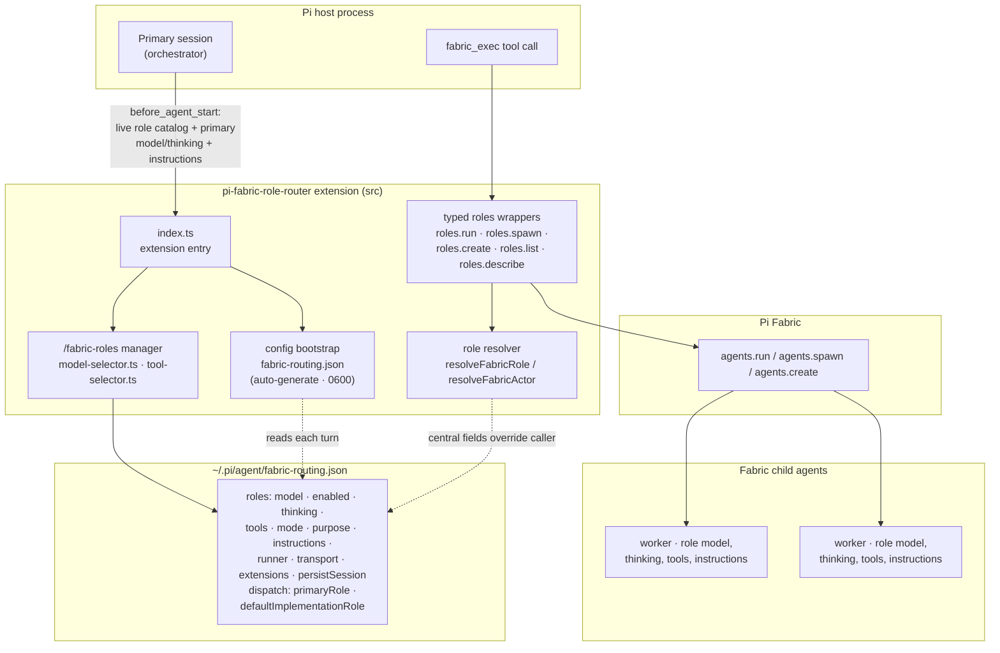
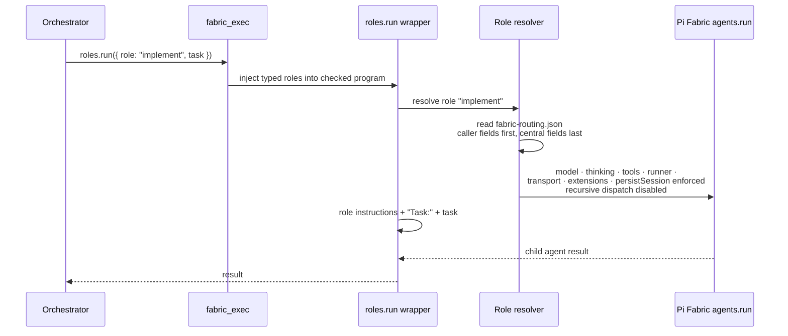
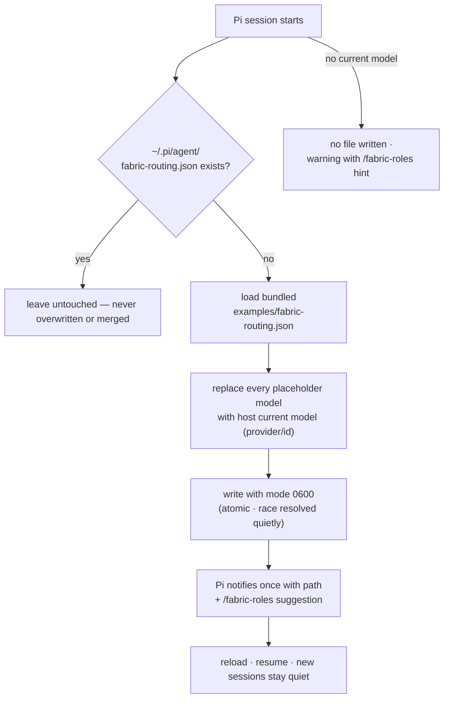
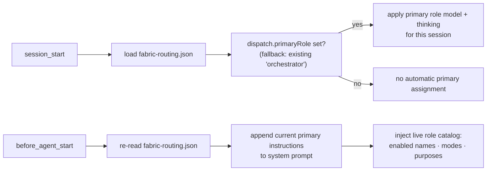
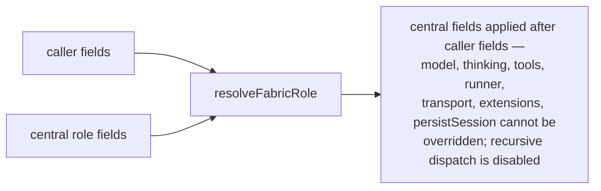

# pi-fabric-role-router — Architecture

> A Pi Fabric extension that adds OMP-style role routing: named roles defined once in `~/.pi/agent/fabric-routing.json`, dispatched with `roles.run()` / `roles.spawn()` / `roles.create()`, and enforced centrally so dispatch sites cannot override model, thinking, tools, runner, transport, extensions, recursion, or session persistence.

| | |
|---|---|
| **Language** | TypeScript · ES Modules |
| **Runtime** | Node.js 24+ · in-process under Pi (requires Pi Fabric 0.21.10+; `persistSession` requires the adjacent feature checkout) |
| **Config** | `~/.pi/agent/fabric-routing.json` (auto-generated on first run, mode `0600`) |
| **Entry points** | `fabric_exec` role wrappers · `/fabric-roles` manager · `before_agent_start` primary assignment |
| **Delegation** | Pi Fabric `agents.run()` · `agents.spawn()` · `agents.create()` |

---

## High-Level Architecture

---

## Dispatch Flow — `roles.run()`

Disabled roles are absent from `roles.list()` and dispatch lookup — a disabled route stays stored and editable but cannot be dispatched until re-enabled.

---

## Startup Bootstrap — First-Run Config Generation

---

## Per-Turn Primary Assignment

The routing file is reloaded on every prompt hook and Fabric dispatch, so instruction and catalog edits take effect on the next turn without reloading the extension. Primary model and thinking changes apply at the next session start. Renaming a role migrates `dispatch.primaryRole` and `dispatch.defaultImplementationRole` references automatically.

---

## Precedence — Central Policy Wins

